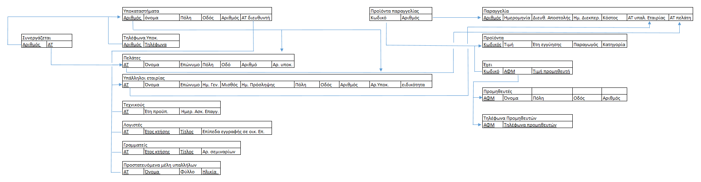

# Relational Model — Modernized Version

The modernized relational model is:

```text
BRANCHES(branch_id PK, name, city, street, street_number, manager_employee_id FK)
BRANCH_PHONES(branch_id PK/FK, phone PK)
CUSTOMERS(customer_id PK, first_name, last_name, city, street, street_number)
BRANCH_CUSTOMERS(branch_id PK/FK, customer_id PK/FK)
EMPLOYEES(employee_id PK, ..., branch_id FK, role)
TECHNICIANS(employee_id PK/FK, years_experience, professional_license_date)
ACCOUNTANTS(employee_id PK/FK, degree_date, degree_title, economic_chamber_level)
SECRETARIES(employee_id PK/FK, degree_date, degree_title, seminar_count)
DEPENDENTS(employee_id PK/FK, dependent_name PK, gender, age)
ORDERS(order_id PK, ..., employee_id FK, customer_id FK)
PRODUCTS(product_code PK, price, warranty_years, manufacturer, category)
ORDER_ITEMS(order_id PK/FK, product_code PK/FK, quantity)
SUPPLIERS(supplier_tax_id PK, name, city, street, street_number)
SUPPLIER_PHONES(supplier_tax_id PK/FK, phone PK)
PRODUCT_SUPPLIERS(product_code PK/FK, supplier_tax_id PK/FK, supplier_price)
```

## Main changes from the original relational implementation

- Correct composite keys for M:N junction tables.
- Monetary values changed from `FLOAT` to `DECIMAL`.
- Phone numbers and supplier identifiers represented as strings.
- Mutable/non-identifying attributes removed from primary keys where appropriate.
- Explicit manager foreign key added.
- Customer/branch relation represented through the M:N junction table only in the modernized reconstruction.

## Original relational-model image


